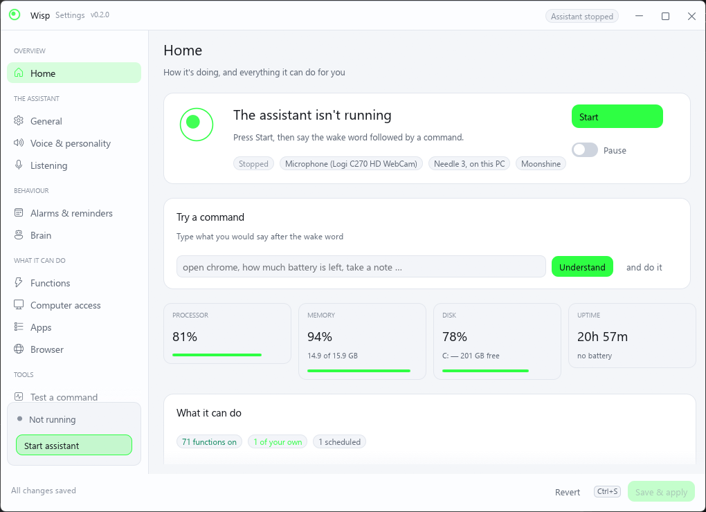
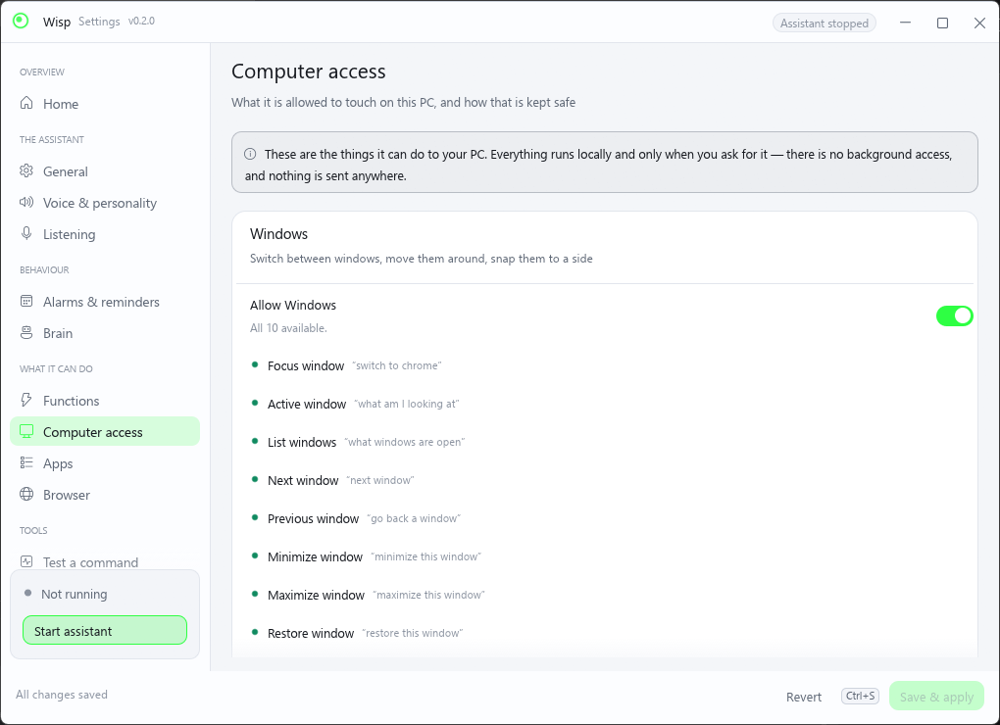
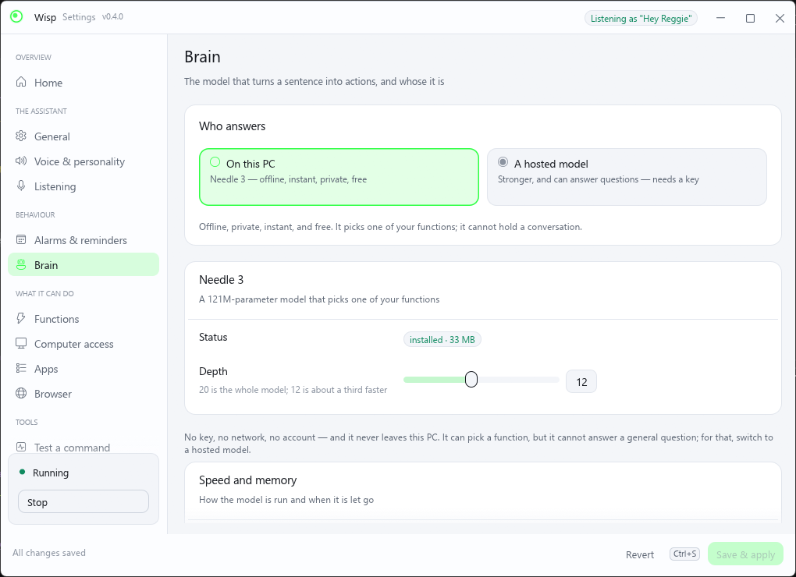
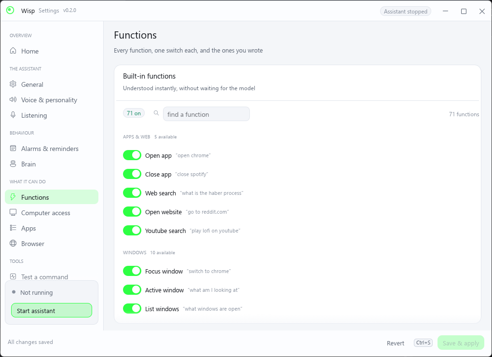
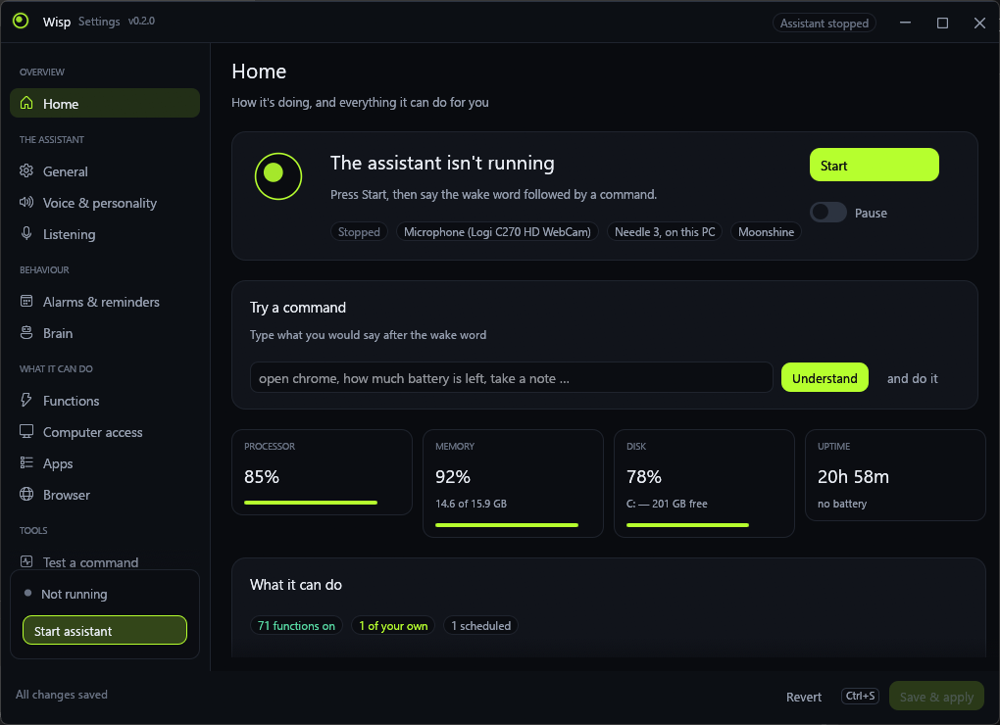
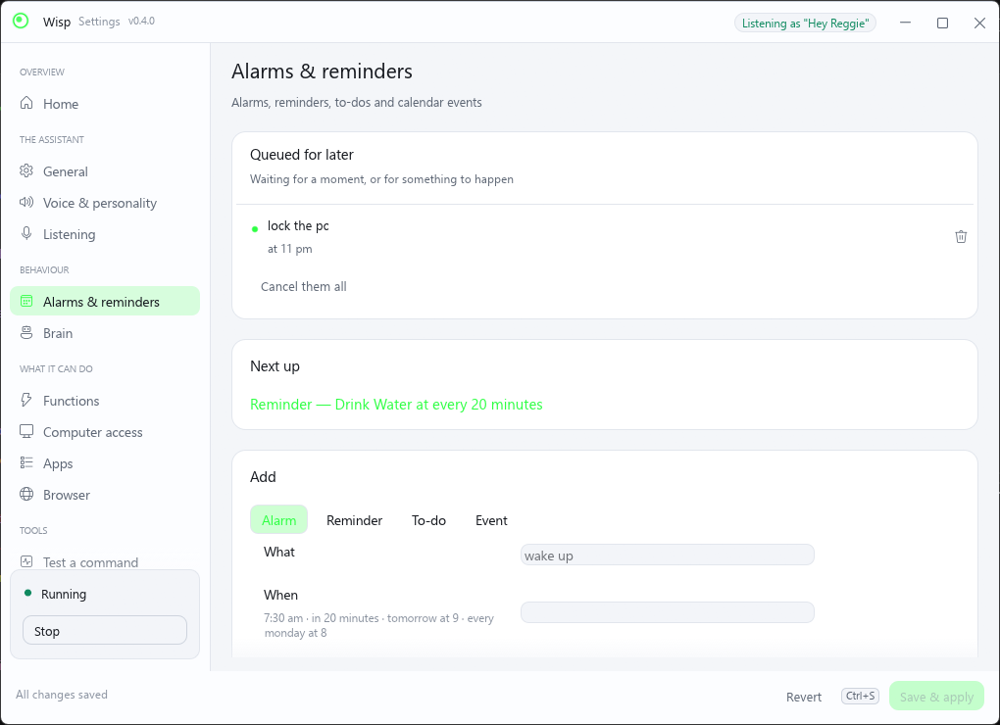

# Wisp

An offline voice assistant for Windows that actually drives the computer. Say
**"Hey Wisp, switch to Chrome"**, **"how much battery is left"**, or **"put the
report in the recycle bin"** — a neon bubble pops up at the bottom of the screen,
works out what you meant, and does it.

Speech recognition, the wake word and — by default — the model that reads your
command all run on this PC. No account, no cloud, no key. If you want a smarter
assistant that can also answer questions, you can point it at a hosted model
with your own API key; everything else stays exactly the same.

> **Wisp is the new name for NeedleVoice (0.2 → 0.3).** The product used to be
> named after the model inside it. It no longer is, because that model is now one
> of two options. Your settings, functions and alarms are carried over from
> `%APPDATA%\NeedleVoice` the first time the new version runs — see
> [Upgrading](#upgrading-from-needlevoice).

## What it looks like

The settings app is a dashboard first: whether it is listening, what it can do,
and the machine it is listening on.

| Home | Computer access |
| --- | --- |
|  |  |

| Brain — whose it is | Functions |
| --- | --- |
|  |  |

| Dark | Queued for later |
| --- | --- |
|  |  |

`Ctrl+1` … `Ctrl+9` move between pages, `Ctrl+S` saves. It follows Windows'
light/dark setting, or you can pin it either way.

## What it can do

Eighty functions, in ten groups. Anything with a phrase in it is understood
**instantly** — no model, no waiting.

### On the machine

This is the half that makes it useful rather than decorative: it can see and
drive the windows, files and settings a person would otherwise click.

| Group | What it does | Say |
|---|---|---|
| **Windows** | Switch to a window, list what is open, minimise, maximise, snap to a side, move to another screen, Alt+Tab | *"switch to chrome"* · *"what windows are open"* · *"snap this to the left"* · *"move this to the other screen"* |
| **Files & notes** | Open your Downloads/Documents/Desktop/Pictures, find a file by name, open it, put it in the recycle bin, measure a folder, keep notes and search them | *"open my downloads"* · *"find the file budget"* · *"delete the file old draft"* · *"how big is my downloads folder"* · *"take a note ring the plumber"* · *"what did I note about the plumber"* |
| **Clipboard & typing** | Copy what you say (or the selection) to the clipboard, read it out, paste, type into the window in front | *"copy this to the clipboard"* · *"what's on my clipboard"* · *"paste it"* · *"type out hello there"* |
| **System** | Battery, processor and memory load, which apps are using them, disk space, whether you are online and your address, this PC's specs, whether an app is running, screenshots (saved or copied) | *"how much battery is left"* · *"what's using my cpu"* · *"how much space is left"* · *"am I online"* · *"what are my specs"* · *"copy a screenshot"* |
| **Power & screen** | Sleep, shut down, restart, sign out (all with a 30-second cancel window), turn the display off, brightness | *"put the computer to sleep"* · *"shut down the computer"* · *"cancel the shutdown"* · *"dim the screen"* |

Deleting a file moves it to the **Recycle Bin**; nothing is ever erased outright.
Shut down and restart wait 30 seconds and can be cancelled by voice. Each one is
the same Win32 call a person would make with the mouse.
[docs/computer.md](docs/computer.md) lists every function, what it touches and
what it will not do.

### When, not now

Anything it can do now, it can do later — or on a condition. There is no
"shutdown timer": there is a queue, and every command can be said with a *when*
attached.

| Say | What happens |
|---|---|
| *"shut down in 30 minutes"* | At that moment. It survives a restart, and is said out loud when it is missed rather than run hours late |
| *"shut down at 9pm"* | The next time the clock shows it |
| *"shut down when I close this application"* | When the window in front of you exits — that exact process, not a name that looks like it |
| *"close chrome when spotify closes"* | Any action, not just power |
| *"lock the pc at 11pm"* · *"dim the screen when I lock it"* · *"play the music when I unplug the charger"* | Any action, any trigger |
| *"open the report when chrome starts"* · *"take a note ring the plumber when the battery drops below 20"* | Programs starting, battery levels, mains, network, the lock screen, idleness, a file appearing |

It confirms what it understood, in your own words: *"I'll shut down at 9 pm"*.
Everything queued is listed in **Settings → Alarms & reminders → Queued for
later**, can be cancelled one at a time or all at once, and the dashboard shows
how many are waiting. By voice: *"what's queued"*, *"what's coming up"*,
*"cancel everything you queued"*.

Edges are edges: *"when I unplug the charger"* said while it is already
unplugged waits for the next unplugging, because the status quo is not an event.
[docs/when.md](docs/when.md) has the full set and the rules.

### Ask it something

The five Ws and the H, each answered by whatever can answer it best: a function
on this machine first, a hosted model if you have one, a web search last.

| | Ask | Answered from |
|---|---|---|
| **Who** | *"who am I"* · *"who's logged in"* · *"what's using my cpu"* | the account, the machine, the process list |
| **What** | *"what's this window"* · *"what's open"* · *"what's on my clipboard"* · *"what can you do"* | the window list, the clipboard, the catalogue |
| **When** | *"when's my next alarm"* · *"how long until 9pm"* · *"what's coming up"* · and everything above | the schedule and the queue |
| **Where** | *"where is my payslip"* · *"where is my downloads folder"* · *"where did I save the build"* | your own folders |
| **Why** | *"why is my computer slow"* · *"why is it lagging"* | the processor, memory, the hungriest app and the free space, in one sentence: *"two things: memory is 94 percent full (14.9 of 15.9 GB), and Chrome alone is using 31 percent of the processor. Closing Chrome should give you the most back."* |
| **How** | *"how much battery is left"* · *"how much space is left"* · *"how many files are in downloads"* · *"how long has the pc been on"* | the machine's own numbers |

A question with no local answer goes to the hosted model when there is one, and
to a web search when there is not — so *"what is the haber process"* still opens
a search rather than pretending to know.

### Everything else

| Group | Say |
|---|---|
| **Apps & web** | *"open chrome"* · *"close spotify"* · *"what is the haber process"* · *"go to reddit.com"* · *"play lofi on youtube"* |
| **Music & sound** | *"pause the music"* · *"next song"* · *"set the volume to 30"* · *"mute"* |
| **Answers** | *"what time is it"* · *"what's the date"* |
| **Schedule** | *"set an alarm for 7:30 am"* · *"remind me to call mum at 4"* · *"add buy milk to my list"* · *"put the dentist on my calendar at 3 pm"* · *"what's on my schedule"* · *"mark buy milk as done"* |
| **Assistant** | *"never mind"*, *"forget it"*, *"stand down"* — back out of a command without it being treated as one |

### Your own functions

Anything else is a **custom function**: a name, a description, parameters, an
action (run a program, open a URL, press keys, run a PowerShell snippet or a
Python script, or chain steps into a sequence), the phrases that trigger it and
what to say back. Templates for the common ones (Spotify search, night light,
focus mode, a morning routine, …) are one click away. A Python function prints
its answer and that answer is spoken.

A function is only as good as the words that reach it, so the phrases are matched
forgivingly — *"hibernate a computer"*, *"hibernate computer"* and
*"hibernet the computer"* all reach the same function — and when the transcript
leads nowhere, another ear hears the clip before anything is said. See
[docs/hearing.md](docs/hearing.md).

### Alarms, reminders, to-dos and events

Times are spoken the natural way — *"in 20 minutes"*, *"tomorrow at 9"*,
*"every weekday at 8"*, *"every 30 minutes"* — and repeat daily, on weekdays,
weekly or monthly. The list lives in `%APPDATA%\Wisp\schedule.json`, it is
announced even while the microphone is paused, and anything missed while the
machine was off is read out when the assistant starts. The whole list exports to
an `.ics` file for Outlook, Google Calendar or a phone.

## Two brains

The command is a sentence with a function to find in it. What finds the function
is the **brain**, and there are two to choose from in Settings → Brain.

| | On this PC (default) | A hosted model |
|---|---|---|
| What runs | **Needle 3** — 121M parameters, 35 MB | OpenAI, Anthropic, Google Gemini, OpenRouter, DeepSeek, Groq, Mistral, xAI, or any OpenAI-compatible server (Ollama, LM Studio, vLLM, Azure, a gateway) |
| Cost | Free | Fractions of a cent per command |
| Speed | Instant for anything with a phrase; a second or two otherwise | A second or two, more with a big model |
| Private | Completely — nothing leaves the machine | Your command goes to the service you chose |
| Can it answer a question? | No. It picks a function; a general question becomes a web search | Yes. It answers in a sentence, and still calls functions when asked |
| Needs | Nothing | An API key, or a local model server |

The key is stored with **DPAPI**, so it is encrypted with your Windows account
and useless on any other machine or account. It is never logged, and the field in
Settings shows only its last four characters. You can pick the model (including
fetching the list your key can actually use) and how hard it should **think** —
off, low, medium or high — which maps to each service's own reasoning control
(`reasoning_effort`, a thinking budget, or Gemini's `thinkingBudget`).

If the hosted model cannot be reached — a dropped connection, an expired key, a
service having a bad day — the assistant falls back to Needle 3 rather than going
quiet, and says so in the log. [docs/brain.md](docs/brain.md) has the setup
detail.

## Speech recognition

| Engine | Per command | Notes |
|---|---|---|
| **Moonshine** (default) | **0.20 s** | English only. Built for short utterances, so it is 30× faster than Whisper here and, on the test clips, more accurate than every Whisper model below |
| SenseVoice | 0.3 s | One model, non-autoregressive; reads Chinese, Japanese, Korean and Cantonese too |
| Whisper `medium.en` | 6.0 s | Multilingual models available; the accurate fallback |

Moonshine comes from `sherpa-onnx`, the same library the voices already use, so
there is nothing new to install. Its models are ~270 MB and Settings fetches them
on demand; until they are there the assistant uses Whisper and says so in the log.

### When it mis-hears you

Any engine can miss an unusual word, and a name you invented for your own
function is the least likely word of all. So a transcript that leads nowhere is
not the end of the attempt: the **caption** already on screen is a second
recogniser that has already run, and another installed engine can re-hear the same
clip in a third of a second. Only if two of them agree, or all of them fail, is the
apology said out loud — and the first apology is held back rather than spoken over
the top of a command that was about to work.

Whisper is tried last, not first: it is the most accurate and about twenty seconds
a clip on this CPU, against 0.3 s for Moonshine. [docs/hearing.md](docs/hearing.md)
has the measurements, including four real recordings of one command that the
selected engine got wrong four times out of four.

### What each Whisper model costs

Measured on this machine (Ryzen 5 2600, 4 threads, a 3-second command) with
`Wisp.exe --bench-stt <model> <clip.wav>`, which is the same code path the
assistant uses:

| Model | Size | Per command | Notes |
|---|---|---|---|
| `tiny.en-q5_1` | 31 MB | 0.44 s | Mishears words, and can loop on a repeat |
| `base.en-q5_1` | 57 MB | 0.65 s | Fine for clear speech |
| `small.en-q5_1` | 181 MB | 2.3 s | The best of the small ones |
| `medium.en-q5_0` | 514 MB | 6.0 s | **Default.** The most accurate that still runs on a CPU |
| `large-v3-turbo-q5_0` | 547 MB | 9.3 s | Larger, and *slower* than medium here: only its decoder is pruned, the encoder is full-size |

There is no small model that matches medium — that is the accuracy/size tradeoff,
not a tuning problem. What does change the picture is the graphics card:

```
cargo build --release -p wisp-agent --features cuda     # needs the CUDA toolkit
cargo build --release -p wisp-agent --features vulkan   # needs the Vulkan SDK
```

Either one runs medium several times faster than this CPU does, which is the only
way to have both accuracy and instant answers. Without it, the useful knobs are
`threads` (one per physical core — a Ryzen 5 2600 should use 6, not 4) and a
smaller model.

## What's inside

| Executable | What it does |
|---|---|
| `WispSetup.exe` | Installer (per-user, no admin). Installing only — removing is the uninstaller's job. |
| `Wisp.exe` | Background agent: tray icon, wake word, bubble, voice. |
| `WispSettings.exe` | Settings app. |
| `WispUninstall.exe` | Uninstaller, written into the install folder as `Uninstall.exe`. Small, no payload. |

### Pipeline

```
mic ─► 16 kHz ─┬─► keyword spotter (3.3 M params, always on) ─► "hey <name>"?
               │                     │
               │      chime + bubble + listening, ~0.3 s after the name
               ▼
          WebRTC VAD ─► Moonshine (only on speech) ─► command
     ─► instant phrase match ─► the brain: Needle 3, or your hosted model
     ─► any of the 80 built-in functions, or one you wrote yourself
     ─► the answer / a personality line ─► Piper or Kokoro neural voice

scheduler ─► alarms · reminders · to-dos · calendar events
          ─► chime + bubble + spoken announcement, then run the function
             the item is wired to
```

* **Wake word**: a dedicated streaming keyword spotter (sherpa-onnx zipformer,
  3.3 M parameters, ~5 MB) listens continuously and fires the moment the name
  ends — no transcription, no waiting for the sentence to finish. It costs about
  1.5 % of one core while silent. The name is turned into the model's sub-word
  tokens in Rust, so any name works, and extra spellings ("no va", "hey novah")
  can be added when an accent keeps being mis-heard. Without the model the agent
  falls back to Whisper plus fuzzy matching.
* **Functions**: every capability is one row in a catalogue that feeds three
  things at once — the tool list handed to the brain, the exact phrases that skip
  the model, and the settings app. Adding a function means adding one row.
* **The brain's prompt is rationed.** Needle reads a prompt at roughly 13 ms per
  position on this class of CPU, so each function definition costs about half a
  second. The full catalogue is several times what fits in its context, so a
  command is scored against the catalogue and only the best seven definitions
  travel with it; if that comes back empty, a wider list is tried once. The
  hosted route has no such limit and gets every function.
* **Changing your mind**: after the wake word you can back out — "never mind",
  "forget it", "cancel that", "turn off", "stand down", "stop listening",
  "that's all". The assistant says one short word and goes back to waiting. The
  words it shares with real commands keep their meaning: "stop the music" still
  pauses, "cancel my alarm" still cancels the alarm.
* **Voice**: Piper (fast, natural, default) or Kokoro (most human-sounding,
  optional 334 MB download), both via sherpa-onnx. The classic Windows voices are
  a fallback.

### Resource use (measured on a Ryzen 5 2600)

* Idle: **~60 MB RAM, ~1.5 % of one core** — the wake-word spotter and the audio
  callback. Every model is loaded when it is needed and freed again after ten
  minutes of quiet (`unload_after_secs`).
* Listening, while in use: **~240 MB** — the chosen engine plus the streaming
  caption model. SenseVoice is 226 MB, Moonshine v2 is 135 MB.
* Second opinions are **borrowed, not kept**: an engine costing more than 250 MB
  is dropped the moment it has spoken. Whisper `medium.en` is the case that
  matters — 514 MB on disk, **804 MB resident**, which is where a Wisp process at
  800 MB came from. It is only ever reached when every cheaper engine has already
  failed on the same clip.
* Settings is a separate window with no models in it: **~100 MB** while open.
* Speech → text: ~0.2–0.4 s. Needle: instant for obvious commands, ~1.5–2.5 s
  otherwise (lower the depth in Settings to speed it up). A hosted model is
  0.5–3 s depending on the model and the thinking level.
* Piper voice: ~0.3 s to synthesise a short reply; 60 MB resident while it is
  loaded.

## Building

Requires Rust (MSVC), CMake and LLVM (for whisper.cpp bindings).

```powershell
powershell -ExecutionPolicy Bypass -File scripts\build-installer.ps1
```

This downloads the bundled models into `models\`, builds everything and writes
`dist\WispSetup.exe`.

Add `-Sign` to Authenticode-sign the installer and every binary it ships, given a
certificate in `$env:WISP_SIGN_CERT` and its password in `$env:WISP_SIGN_PASSWORD`.
Signing is worth doing — Defender's machine-learning heuristic once quarantined
this installer as `Trojan:Win32/WacatacB!ml`. That was a false positive caused by
the build's shape, and `docs\installer.md` records what it was and the rules that
keep it fixed.

`.cargo\config.toml` matters: it forces `/O2` and AVX2 for whisper.cpp. Without
it, MSVC builds whisper.cpp unoptimised and it runs about 30× slower.

### Handy flags

* `Wisp.exe --demo`: plays through every bubble state.
* `Wisp.exe --say "text" [--config file.toml]`: speak once (used by voice preview).
* `Wisp.exe --chime`: play the wake-up chime once (used by the settings app).
* `Wisp.exe --ask "<command>" [--do]`: what it makes of a sentence — the route, the actions,
  and what it would say. `--do` runs them, which is how the queue is exercised by hand.
* `Wisp.exe --bench-needle "<command>" [depth]`: where a command's milliseconds go.
* `Wisp.exe --bench-stt <model> <clip.wav>`: time a recogniser on a real clip.
* `WispSettings.exe --tab home|computer|voice|listening|schedule|brain|browser|apps|functions|test`
* `WispSettings.exe --config other.toml`: edit a different settings file (handy for
  trying a set of functions without touching the live ones).
* `WISP_FAKE_MIC=<16 kHz mono wav>` plays a file into the agent in real time,
  which is how the wake word is tested without a microphone.
* `WispSetup.exe --silent [--dir X] [--no-launch] [--no-autostart]`
* `Uninstall.exe --uninstall [--dir X] [--delete-settings]` — both `--` and `/`
  forms are accepted, because that is how launchers rewrite it.

Settings are stored in `%APPDATA%\Wisp\config.toml`, the queue of "when" actions in
`pending.json`, the schedule in `schedule.json` and your notes in `notes.md`; the log
is `agent.log`, all in the same folder. The agent restarts itself when settings change.

## Upgrading from NeedleVoice

The rename only touches the product's own name: settings, the schedule file,
your custom functions, the scripts folder and a notes file are copied from
`%APPDATA%\NeedleVoice` to `%APPDATA%\Wisp` the first time the new build starts,
and the old folder is left alone (nothing is moved or deleted). The copy happens
only when the new folder has no `config.toml` of its own, so it never overwrites
anything.

The install itself is new — `%LOCALAPPDATA%\Programs\Wisp` rather than
`…\NeedleVoice` — so run `WispSetup.exe`, then remove the old copy from Windows'
"Installed apps".

## Layout

```
crates/wisp-core      config, app discovery, the function catalogue (built-ins +
                      custom, Python + step sequences), the two brains (Needle and
                      the hosted client), the machine itself (windows, clipboard,
                      files, power), action runner, schedule store + spoken-time
                      parser, the "when" triggers and the queue built on them, wake
                      parsing, model downloaders, personality lines
crates/wisp-agent     audio, VAD, Moonshine/Whisper, keyword spotter, listener
                      state machine, alarm scheduler, bubble overlay, tray,
                      neural TTS playback
crates/wisp-config    settings UI (egui)
crates/wisp-setup     installer with embedded zstd payload — installs only
crates/wisp-uninstall uninstaller, a separate small program (see docs/installer.md)
crates/wisp-version   shared Windows version resources, icon and manifest
```

## Licence

MIT — see [LICENSE](LICENSE). The models and libraries this project is built on
keep their own licences; [CREDITS.md](CREDITS.md) lists them, and doubles as the
NOTICE that Apache-2.0 components (Needle 3, sherpa-onnx) ask for.

## Credits

The interesting parts of this project belong to other people. The default
on-device brain is **Needle 3** by [Cactus Compute, Inc.](https://huggingface.co/Cactus-Compute/needle3)
(Apache-2.0), running on the [needle-rs](https://github.com/geekgineer/needle-rs)
engine; the speech is **whisper.cpp** and **sherpa-onnx**, with the wake-word
model, Piper voices and **Kokoro** voices from the k2-fsa and rhasspy projects.
See [CREDITS.md](CREDITS.md) for the full list, the licences, and the citation
the Needle authors ask for:

```bibtex
@misc{needle3_2026,
  title        = {Needle: Foundation Tool-Calling Model for Tiny Devices},
  author       = {Ndubuaku, Henry and Mosoyan, Karen and Mroz, Jakub and Cylich, Noah and
                  Kumar, Satyajit and Sandhu, Parkirat and Shemet, Roman and Lee, Justin H.},
  year         = {2026},
  organization = {Cactus Compute, Inc.},
  howpublished = {\url{https://github.com/cactus-compute/needle}}
}
```

## Building from a clone

Models are not in the repository — they are a few hundred megabytes and each one
belongs to its publisher. Fetch them, then build:

```powershell
./scripts/fetch-models.ps1        # Needle + the wake-word pack + a voice + Moonshine
cargo build --release
./scripts/build-installer.ps1     # optional: dist\WispSetup.exe
```

The tests that need a model skip themselves when it isn't there.
